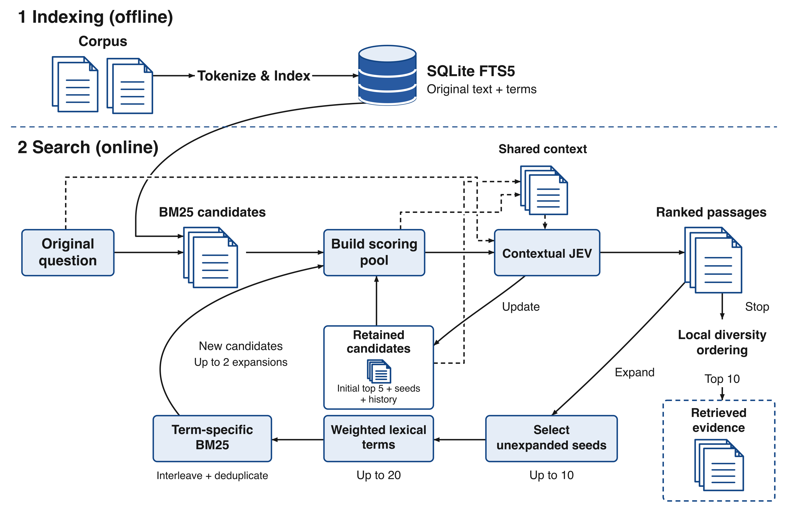

<p align="center"></p>

# SAG2

> SAG2 论文的配套 Benchmark 复现仓库，提供论文实验的代码、数据与运行说明。实际应用请查看 [SAG-Wiki](https://github.com/Zleap-AI/SAG-Wiki)。

[English](README.md) | **简体中文**

**论文：** [SAG2: Embedding-Free Multi-Hop Retrieval with BM25 and JEV (arXiv:2610.22588)](https://arxiv.org/abs/2610.22588)

**SAG2：无需嵌入模型的多跳证据检索。** 使用 SQLite FTS5、BM25 和 JEV，在查询时沿“问题 → 段落 → 词项 → 新段落”寻找证据。导入阶段只构建本地词法索引；Agentic SAG2 和本地 Rerank 是可选扩展。

**原 SAG 论文复现入口：[sag/README-CN.md](sag/README-CN.md)**。原方法的安装、数据上传、检索、问答与评测说明保留在独立的 `sag/` 目录。

<video src="https://github.com/Zleap-AI/SAG-Benchmark/raw/refs/heads/main/sag2/assets/SAG2-%E4%B8%AD%E6%96%87.mp4" controls width="100%"></video>

**目录**

- **SAG2**
  - [Benchmark 分数复现](#benchmark-分数复现)
  - [方法流程](#方法流程)
  - [快速开始](#快速开始)
  - [数据集](#数据集)
  - [检索配置与参数](#检索配置与参数)
  - [输出与恢复](#输出与恢复)
  - [常用脚本](#常用脚本)
- **扩展方法**
  - [Agentic SAG2](#agentic-sag2)
  - [本地 Rerank](#本地-rerank)
  - [运行其他项目](#运行其他项目)
- **代码与复现**
  - [代码与数据目录](#代码与数据目录)
  - [复现说明与消融](#复现说明与消融)
  - [索引与费用](#索引与费用)
  - [索引与实验设置](#索引与实验设置)
  - [离线核对](#离线核对)

## Benchmark 分数复现

SAG2 在 MuSiQue、2WikiMultiHopQA、HotpotQA 各评测1,000题。R@10 分别为 **86.62%、97.43%、99.00%**；EnterpriseRAG-Bench 覆盖 **511,962篇源文档**，470道有标签问题的文档R@10为 **81.10%**。

下表为论文主表，实验设置见[复现说明](#索引与实验设置)。数值为百分比，粗体表示该列最高值。R@k 衡量前k个去重结果找回的标准证据比例；AE@k 衡量是否找齐全部证据。**表中R@k为证据召回率。**

<table>
  <thead>
    <tr><th rowspan="2">方法</th><th colspan="4">MuSiQue</th><th colspan="4">2WikiMultiHopQA</th><th colspan="4">HotpotQA</th></tr>
    <tr><th>R@1</th><th>R@2</th><th>R@5</th><th>R@10</th><th>R@1</th><th>R@2</th><th>R@5</th><th>R@10</th><th>R@1</th><th>R@2</th><th>R@5</th><th>R@10</th></tr>
  </thead>
  <tbody>
    <tr><th colspan="13">基础检索</th></tr>
    <tr><td>BM25</td><td align="right">28.53</td><td align="right">37.32</td><td align="right">47.47</td><td align="right">54.41</td><td align="right">40.10</td><td align="right">57.93</td><td align="right">67.05</td><td align="right">71.50</td><td align="right">39.75</td><td align="right">57.95</td><td align="right">74.40</td><td align="right">86.90</td></tr>
    <tr><td>Contriever</td><td align="right">24.50</td><td align="right">33.54</td><td align="right">45.32</td><td align="right">53.58</td><td align="right">34.40</td><td align="right">48.60</td><td align="right">59.25</td><td align="right">65.20</td><td align="right">39.30</td><td align="right">57.45</td><td align="right">74.85</td><td align="right">82.75</td></tr>
    <tr><th colspan="13">大规模嵌入模型</th></tr>
    <tr><td>BGE-Large-EN-v1.5</td><td align="right">29.42</td><td align="right">41.68</td><td align="right">56.32</td><td align="right">64.08</td><td align="right">41.48</td><td align="right">62.28</td><td align="right">69.83</td><td align="right">73.75</td><td align="right">45.45</td><td align="right">76.20</td><td align="right">89.20</td><td align="right">93.35</td></tr>
    <tr><td>GTE-Qwen2-7B</td><td align="right">35.19</td><td align="right">48.06</td><td align="right">61.92</td><td align="right">70.80</td><td align="right">43.45</td><td align="right">65.58</td><td align="right">74.18</td><td align="right">78.63</td><td align="right">46.40</td><td align="right">73.95</td><td align="right">88.45</td><td align="right">93.55</td></tr>
    <tr><td>GritLM-7B</td><td align="right">34.86</td><td align="right">50.70</td><td align="right">66.22</td><td align="right">75.19</td><td align="right">41.85</td><td align="right">66.23</td><td align="right">75.62</td><td align="right">79.40</td><td align="right">46.40</td><td align="right">81.15</td><td align="right">93.40</td><td align="right">97.20</td></tr>
    <tr><td>NV-Embed-v2</td><td align="right">34.02</td><td align="right">51.08</td><td align="right">68.84</td><td align="right">77.27</td><td align="right">43.23</td><td align="right">68.93</td><td align="right">77.00</td><td align="right">80.75</td><td align="right">46.90</td><td align="right">85.55</td><td align="right">95.25</td><td align="right">97.70</td></tr>
    <tr><th colspan="13">结构增强检索</th></tr>
    <tr><td>HippoRAG 2</td><td align="right">30.65</td><td align="right">49.52</td><td align="right">65.13</td><td align="right">73.76</td><td align="right">42.38</td><td align="right">76.55</td><td align="right">90.35</td><td align="right">93.40</td><td align="right">44.40</td><td align="right">78.35</td><td align="right">94.35</td><td align="right">97.15</td></tr>
    <tr><td>SAG (Ours)</td><td align="right"><strong>36.82</strong></td><td align="right"><strong>63.62</strong></td><td align="right">80.36</td><td align="right">83.37</td><td align="right"><strong>43.81</strong></td><td align="right">83.93</td><td align="right">93.34</td><td align="right">93.57</td><td align="right">47.80</td><td align="right">91.55</td><td align="right">96.50</td><td align="right">97.70</td></tr>
    <tr><td><strong>SAG2 (Ours)</strong></td><td align="right">34.30</td><td align="right">62.18</td><td align="right"><strong>80.68</strong></td><td align="right"><strong>86.62</strong></td><td align="right">43.55</td><td align="right"><strong>85.50</strong></td><td align="right"><strong>97.35</strong></td><td align="right"><strong>97.43</strong></td><td align="right"><strong>48.30</strong></td><td align="right"><strong>93.60</strong></td><td align="right"><strong>98.45</strong></td><td align="right"><strong>99.00</strong></td></tr>
  </tbody>
</table>

主表的BM25为论文固定参考值，其他基线来源见 [主表数据](sag2/results/paper/main-results.json)。三个多跳数据集使用固定开发集子集，MuSiQue含518道两跳、316道三跳、166道四跳，且用于方法开发。企业文档结果见下表；[消融](#复现说明与消融)与Agentic结果在后文单独报告。

EnterpriseRAG-Bench共511,962篇源文档，下表为470道有标签问题的文档R@10（%）。

| 问题类型 | n | BM25 | Vector | Bash Agent† | **SAG2 (Ours)** |
| --- | --- | --- | --- | --- | --- |
| 基础检索 | 175 | 77.7 | 48.6 | 61.7 | **86.86** |
| 语义检索 | 125 | 43.2 | 24.8 | 29.6 | **58.40** |
| 文档内推理 | 40 | 90.0 | 57.5 | 75.0 | **100.00** |
| 项目关联 | 40 | 65.5 | 49.2 | 43.2 | **83.58** |
| 限定条件 | 30 | 85.0 | 83.3 | 78.3 | **96.67** |
| 信息冲突 | 20 | 82.5 | 55.0 | 72.5 | **92.50** |
| 完整性 | 20 | 46.5 | 33.4 | 59.0 | **76.24** |
| 其他 | 20 | 90.0 | 75.0 | 100.0 | **100.00** |
| 总体 | 470 | 68.4 | 46.0 | 55.8 | **81.10** |

Enterprise基线引自[原论文](https://arxiv.org/abs/2605.05253)；Bash Agent返回数量可变，其他表中方法取十个文档，预算不完全一致。

## 方法流程



1. **索引原文。** 分词后写入SQLite FTS5，保留来源、章节与词频；无需嵌入或离线语义抽取。
2. **问题检索段落。** BM25取最多100个候选，JEV `noul` 根据原问题及已有证据判断每段的证据价值。
3. **段落提取词项。** 从最多10个扩展起点选出最多20个词项，综合词频、稀有度、问题联系及JEV评分。
4. **检索更多证据。** 按词项分别查询、交错合并和去重，加入保留证据后重新评分；默认追加两轮。
5. **输出来源。** 对前十个结果进行本地多样性排序，不增加模型请求。

JSON语料默认按纯文本分段；提供`path`时按文件后缀识别Markdown或代码。原文不添加生成式批注。标准答案与证据标注只用于评测，不传入检索模型。算法、提示词与优化实现位于 [scripts/sag2.py](sag2/scripts/sag2.py)；原 SAG 的事件／实体路线见 [sag/](sag/README-CN.md)。

## 快速开始

以下命令均在 **SAG-Benchmark/sag2/** 目录执行。原 SAG 读者请先进入 [sag/README-CN.md](sag/README-CN.md)，使用该子项目独立的依赖和配置。

### 1. 安装

需要 Python **3.11+**、[uv](https://docs.astral.sh/uv/getting-started/installation/) 和 C 编译器。首次使用会编译SQLite评分扩展；macOS使用Xcode Command Line Tools，Linux使用GCC或Clang，Windows使用MSVC Build Tools。SAG2默认安装不需要Docker、MySQL、Elasticsearch或GPU。Shell示例使用Bash（Linux、macOS或WSL）；PowerShell可用Copy-Item复制配置。论文对照脚本目前要求类Unix环境。

```bash
git clone https://github.com/Zleap-AI/SAG-Benchmark.git
cd SAG-Benchmark/sag2
uv sync --frozen
```

已有仓库时，从仓库根目录执行 `cd sag2`。后续SAG2命令均在这个目录运行，使用 `sag2/.venv/`。

### 2. 配置 JEV

首次运行复制配置；已有配置请保留：

```bash
test -f .env || cp .env.example .env
```

在当前目录的 `.env` 中填写（仓库路径为 `sag2/.env`）：

```dotenv
OPENROUTER_API_KEY=your_api_key
JEV_BASE_URL=https://openrouter.ai/api/alpha/decisions
JEV_MODEL=typesafe/jev-1.13
```

默认评分类型为 `noul`。历史论文记录的实际返回模型为 `typesafe/jev-1.13-20260917`；服务商模型版本可能变化，应以运行记录为准。密钥通过环境变量或 `--env-file` 读取，不放在命令行中。

### 3. 准备数据和索引

```bash
# 下载缺少的固定数据文件，构建三个数据集索引；不请求模型
uv run python scripts/run_sag2_benchmark.py --download --index-only
```

已存在的同语料、同切片配置索引会被复用。终端显示各数据集的原文数、片段数、题数，汇总状态为 `indexed`。默认索引位于 `.cache/sag2/`。需要单个数据集时加 `--dataset musique`。

### 4. 先跑10题

```bash
uv run python scripts/run_sag2_benchmark.py \
  --dataset musique --limit 10 --concurrency 20 \
  --output-dir output/sag2/musique-smoke
```

`--limit` 只限制评测题数，检索仍覆盖完整语料。此步骤会产生Jev API费用；完成后终端输出Recall指标。逐题结果位于 `output/sag2/musique-smoke/musique/details.jsonl`，分数位于同目录的 `metrics.json`。

### 5. 全量运行

```bash
# 三个数据集各1,000题
uv run python scripts/run_sag2_benchmark.py --datasets all --concurrency 20

# 或只运行指定数据集
uv run python scripts/run_sag2_benchmark.py \
  --datasets hotpotqa 2wikimultihopqa --concurrency 20
```

需要明确保存位置时，加 `--output-dir output/sag2/my-run`；新运行要求该目录尚不存在。检查依赖、数据和小规模结果后再运行全量。

## 数据集

| 数据集参数 | 题数 | 原文段落／文档数 | 评测单位 |
|---|---:|---:|---|
| `musique` | 1,000 | 11,656 | 支持段落 |
| `2wikimultihopqa` | 1,000 | 6,119 | 支持段落 |
| `hotpotqa` | 1,000 | 9,811 | 支持段落 |
| EnterpriseRAG-Bench，独立入口 | 470道有标签问题 | 511,962 | 源文档 |

三个多跳数据集来自 HippoRAG 2，固定数据修订为 `5ec05b38deecc3318bb432c69865959c56058990`。`--datasets all` 包含前三项；Enterprise使用下方独立入口。数据格式与许可见 [dataset/README.md](sag2/dataset/README.md)。

### EnterpriseRAG-Bench

准备官方数据目录，其中包含 `documents/`、`questions.jsonl`、`download_manifest.json`。**先检查是否已有匹配索引，避免重复建库。**

```bash
# 仅在首次构建当前格式索引时运行；请使用新路径保存
uv run python scripts/build_enterprise_index.py \
  --dataset-dir ../../datasets/EnterpriseRAG-Bench \
  --index-path .cache/sag2/enterprise.sqlite \
  --output-dir output/enterprise/index

# 复用上一步已有索引，运行全部470道有标签问题
uv run python scripts/run_enterprise.py \
  --dataset-dir ../../datasets/EnterpriseRAG-Bench \
  --index-summary output/enterprise/index/summary.json \
  --output-dir output/enterprise/evaluation --concurrency 20
```

评测入口只读打开索引，输出 `progress.json`、`summary.json`、逐题 `qst_*.json` 和 `requests/`。再次运行相同命令会复用已保存结果；模型、数据或配置变化时使用新输出目录。旧schema 4索引不能直接传给当前schema 5的Enterprise读取器；保留旧索引并使用匹配的兼容实现，不能通过改版本标记完成转换。

## 检索配置与参数

| 参数 | 默认值 | 作用 |
|---|---|---|
| `--mode` | `sag2` | 可选 `sag2`、`agentic`、`local` |
| `--dataset` / `--datasets` | `all` | 一个或多个多跳数据集 |
| `--dataset-dir` | `dataset/` | 数据文件目录，默认位于 `sag2/dataset/` |
| `--limit` / `--offset` | 全部 / `0` | 题目范围，语料保持完整 |
| `--concurrency` | `20` | 问题并发上限 |
| `--index-workers` | `8` | 建库进程数，和问题并发分开 |
| `--candidate-k` | `100` | 每轮词法候选上限 |
| `--seed-k` | `10` | 每轮扩展起点上限 |
| `--expansions` / `--max-hops` | SAG2为`2`；Agentic为`1` | 初始检索后的追加轮数，可设0、1、2 |
| `--expansion-term-limit` | `20` | 每轮扩展词项上限 |
| `--top-k` / `--k-list` | `10` / `1 2 5 10` | 输出与评测截点 |
| `--chunk-chars` | `2200` | 切片目标长度，按UTF-16单位计数 |
| `--cache-dir` | `.cache/sag2` | SQLite索引目录 |
| `--output-dir` | 自动时间目录 | 新运行保存位置 |
| `--resume` | 无 | 使用原配置继续已有运行 |
| `--env-file` | `sag2/.env`（仓库路径） | 配置文件位置，可用 `SAG_ENV_FILE` 覆盖默认值 |

```bash
# 示例：追加一轮扩展，仍保留100个候选和10个起点
uv run python scripts/run_sag2_benchmark.py \
  --dataset musique --limit 10 --expansions 1 --candidate-k 100 --seed-k 10

uv run python scripts/run_sag2_benchmark.py --help
```

改变模型、切片或检索参数会改变实验条件。要比较论文分数，请同时核对模型版本、语料、题目、切片和指标单位。

## 输出与恢复

以下输出路径相对于 `SAG-Benchmark/sag2/`。默认结构：

```text
output/sag2/<时间>/
├── summary.json
└── <数据集>/
    ├── config.json
    ├── details.jsonl
    ├── metrics.json
    ├── search_results.json
    ├── bm25_results.json
    └── requests/          # Agentic / 本地Rerank模式
```

| 文件 | 内容与成功标志 |
|---|---|
| `summary.json` | 各数据集的最终汇总；仅建库时状态为 `indexed` |
| `config.json` | 模型、参数、数据和代码校验值 |
| `details.jsonl` | 每行一道已完成题目，含检索结果、召回和用量 |
| `metrics.json` | 该数据集完成后的整体指标、全部证据召回和用量 |
| `search_results.json` | 每题最终检索原文，供后续问答或分析读取 |
| `bm25_results.json` | 同题初始BM25检索结果，供对照分析 |
| `requests/` | Agentic和本地模式的请求、响应与恢复记录 |

```bash
# 使用原数据集、范围、模型与参数，继续未完成的运行
uv run python scripts/run_sag2_benchmark.py \
  --dataset musique --limit 10 --concurrency 20 \
  --resume output/sag2/musique-smoke
```

普通SAG2复用已完成题目；Agentic和本地模式还会复用相同请求的成功响应。普通SAG2不保存逐个Jev请求的恢复日志，题目中途失败后可能需要重新请求该题。不要将不同模型或参数的结果混入同一输出目录。

## 常用脚本

| 脚本 | 用途 |
|---|---|
| `scripts/run_sag2_benchmark.py` | 多跳数据集建库、SAG2、Agentic与本地Rerank评测 |
| `scripts/build_enterprise_index.py` | Enterprise全库建库 |
| `scripts/run_enterprise.py` | Enterprise只读索引评测 |
| `scripts/run_paper_controls.py` | MuSiQue论文对照，包含模型调用 |
| `scripts/verify_paper_results.py` | 从保留记录复核论文数据，不请求模型 |
| `scripts/verify_agentic_results.py` | 复核3,000题最佳Agentic记录 |
| `scripts/verify_rerank_results.py` | 复核保留的Rerank结果 |
| `scripts/search_local.py` | 使用本地Rerank查询自有JSON语料 |

SAG2当前入口返回证据，不包含原SAG的答案生成和LLM Judge流程。原论文的上传、检索、问答和Judge命令完整保留在 [sag/](sag/README-CN.md)。

## Agentic SAG2

**可选扩展。** LLM保留原问题和检索历史，将SAG2作为工具调用，决定后续查询、停止和最终十段排序；不在索引阶段添加生成内容。

三个数据集各1,000题的最佳结果如下。MuSiQue **R@5达到92.20%**，比单次SAG2提高11.53个百分点（按未四舍五入值计算）；R@10达到95.39%。2WikiMultiHopQA和HotpotQA的R@5分别为99.88%和99.30%。

<table>
  <thead>
    <tr><th rowspan="2">方法</th><th colspan="4">MuSiQue</th><th colspan="4">2WikiMultiHopQA</th><th colspan="4">HotpotQA</th></tr>
    <tr><th>R@1</th><th>R@2</th><th>R@5</th><th>R@10</th><th>R@1</th><th>R@2</th><th>R@5</th><th>R@10</th><th>R@1</th><th>R@2</th><th>R@5</th><th>R@10</th></tr>
  </thead>
  <tbody>
    <tr><td>SAG2</td><td align="right">34.30</td><td align="right">62.18</td><td align="right">80.68</td><td align="right">86.62</td><td align="right">43.55</td><td align="right">85.50</td><td align="right">97.35</td><td align="right">97.43</td><td align="right">48.30</td><td align="right">93.60</td><td align="right">98.45</td><td align="right">99.00</td></tr>
    <tr><td><strong>Agentic SAG2</strong></td><td align="right"><strong>38.21</strong></td><td align="right"><strong>71.99</strong></td><td align="right"><strong>92.20</strong></td><td align="right"><strong>95.39</strong></td><td align="right"><strong>44.08</strong></td><td align="right"><strong>88.00</strong></td><td align="right"><strong>99.88</strong></td><td align="right"><strong>99.88</strong></td><td align="right"><strong>49.10</strong></td><td align="right"><strong>96.45</strong></td><td align="right"><strong>99.30</strong></td><td align="right"><strong>99.65</strong></td></tr>
  </tbody>
</table>

评测设置：`gpt-6.1-sol`、`high`，每次SAG2追加1轮扩展，每题最多3次工具调用，每次返回20段，最终选10段。通用API入口无需Codex账号或CLI；历史分数来自原生MCP运行。

```dotenv
LLM_API_KEY=your_llm_key
LLM_BASE_URL=https://api.openai.com/v1
LLM_MODEL=gpt-6.1-sol
LLM_API=responses
LLM_REASONING_EFFORT=high
```

```bash
uv run python scripts/run_sag2_benchmark.py --mode agentic \
  --dataset musique --limit 10 --expansions 1 --max-tool-calls 3 --return-k 20
```

支持 `--llm-model`、`--llm-base-url`、`--llm-api responses|chat`、`--llm-api-key-env`、`--reasoning-effort`。服务商须支持对应工具调用格式。完整配置、Token和费用见 [Agentic指南](sag2/docs/agentic.md)及[最佳结果](sag2/results/agentic/README.md)。

## 本地 Rerank

**可选扩展。** 用本机模型替代每轮Jev评分，保留BM25、词项扩展和最终多样性排序。权重和数据准备完成后可以离线运行。

以下结果通过302接口评测，每个数据集1,000题：

<table>
  <thead>
    <tr><th rowspan="2">方法</th><th colspan="4">MuSiQue</th><th colspan="4">2WikiMultiHopQA</th><th colspan="4">HotpotQA</th></tr>
    <tr><th>R@1</th><th>R@2</th><th>R@5</th><th>R@10</th><th>R@1</th><th>R@2</th><th>R@5</th><th>R@10</th><th>R@1</th><th>R@2</th><th>R@5</th><th>R@10</th></tr>
  </thead>
  <tbody>
    <tr><td>BM25</td><td align="right">28.71</td><td align="right">37.50</td><td align="right">47.66</td><td align="right">54.50</td><td align="right">40.25</td><td align="right">58.18</td><td align="right">67.08</td><td align="right">71.58</td><td align="right">39.75</td><td align="right">58.05</td><td align="right">74.45</td><td align="right">86.95</td></tr>
    <tr><td>SAG2 + Jev（同批对照）</td><td align="right">34.24</td><td align="right">62.34</td><td align="right">80.59</td><td align="right">86.61</td><td align="right">43.55</td><td align="right">85.50</td><td align="right">97.35</td><td align="right">97.43</td><td align="right">48.30</td><td align="right">93.60</td><td align="right">98.45</td><td align="right">99.00</td></tr>
    <tr><td>SAG2 + Jina（两次扩展）</td><td align="right">31.03</td><td align="right">50.38</td><td align="right">65.61</td><td align="right">72.13</td><td align="right">43.10</td><td align="right">70.15</td><td align="right">80.80</td><td align="right">86.95</td><td align="right">46.75</td><td align="right">85.55</td><td align="right">94.35</td><td align="right">97.00</td></tr>
  </tbody>
</table>

<details>
<summary>MuSiQue：模型与流程消融</summary>

| MuSiQue 消融 | R@1 | R@2 | R@5 | R@10 | 全部证据@10 |
|---|---:|---:|---:|---:|---:|
| BM25 | 28.71 | 37.50 | 47.66 | 54.50 | 17.50 |
| BM25＋Qwen 单轮评分 | 31.66 | 45.44 | 60.17 | 66.88 | 32.50 |
| BM25＋Jina 单轮评分 | 35.01 | 52.18 | 63.04 | 67.43 | 34.70 |
| SAG2＋Qwen 两次扩展 | 22.64 | 34.75 | 55.55 | 71.61 | 44.60 |
| SAG2＋Qwen 0.6B 两次扩展 | 25.67 | 40.81 | 62.54 | 74.18 | 48.40 |
| SAG2＋Jina 两次扩展 | 31.03 | 50.38 | 65.61 | 72.13 | 43.80 |
| SAG2＋Jev 基线 | 34.24 | 62.34 | 80.59 | 86.61 | 69.00 |

单轮使用原问题与标准相关性提示词；两次扩展使用SAG2证据提示词、上下文和最终DPP。差值同时包含流程与提示词差异。`qwen3-rerank` 与Qwen 0.6B为不同型号。
</details>

```bash
# 有网络时准备依赖和固定修订权重
uv sync --frozen --group local
uv run --group local hf download Qwen/Qwen3-Reranker-0.6B \
  --revision e61197ed45024b0ed8a2d74b80b4d909f1255473 --local-dir models/qwen3-reranker-0.6b

# 数据与权重齐备后，离线跑10题
uv run --offline --group local python scripts/run_sag2_benchmark.py \
  --mode local --reranker qwen --model-path models/qwen3-reranker-0.6b \
  --dataset musique --limit 10 --expansions 2 --concurrency 20
```

支持Qwen Transformers、Jina Transformers和Apple Silicon的Jina MLX后端。Qwen权重为Apache-2.0；Jina为CC BY-NC 4.0，商业使用另需许可。自有语料、显存与批大小、完整消融见 [本地Rerank指南](sag2/docs/local-rerank.md)。

## 运行其他项目

五个外部方法位于 `sag/external/`，各自使用独立环境，统一读取 `sag/.env`。完整步骤、输出与Judge评测见[外部方法指南](sag/external/README.md)。

| 方法 | 复现指南 |
|---|---|
| Microsoft GraphRAG | [graphrag](sag/external/graphrag/README.md) |
| HippoRAG 2 | [hipporag2](sag/external/hipporag2/README.md) |
| HyperGraphRAG | [hypergraphrag](sag/external/hypergraphrag/README.md) |
| Hyper-RAG | [hyperrag](sag/external/hyperrag/README.md) |
| LightRAG | [lightrag](sag/external/lightrag/README.md) |

以HippoRAG 2为例：先将 `sag/.env.example` 复制为 `sag/.env`，填写LLM和Embedding配置，已有配置请保留。以下命令从 **SAG-Benchmark根目录** 执行，复用前面下载的MuSiQue数据：

```bash
cd sag/external/hipporag2
uv sync --frozen
uv run --frozen --env-file ../../.env python reproduce/Step_0_load_dataset.py \
  --data_name musique --dataset-root ../../../sag2/dataset
uv run --frozen --env-file ../../.env python reproduce/Step_1_build_index.py --data_name musique
uv run --frozen --env-file ../../.env python reproduce/Step_3_response.py --data_name musique
```

流程为数据准备、建索引、检索与问答，后两步会调用模型。GraphRAG使用独立的检索、问答步骤；Hyper-RAG还需Hypergraph-DB。具体参数与数据位置按各方法指南配置，统一Judge在 `sag/` 目录运行。

## 代码与数据目录

```text
SAG-Benchmark/
├── README.md / README-CN.md   # SAG2 introduction, results and reproduction / SAG2介绍、成绩与复现
├── sag/                      # Original SAG / 原SAG
│   ├── README.md / README-CN.md
│   ├── pipeline/ / scripts/ / prompts/
│   ├── external/             # GraphRAG, HippoRAG 2, HyperGraphRAG, Hyper-RAG, LightRAG
│   └── pyproject.toml / uv.lock / docker-compose.yml
└── sag2/                     # SAG2 and its optional extensions
    ├── README.md / README-CN.md
    ├── pyproject.toml / uv.lock / .env.example
    ├── scripts/
    │   ├── run_sag2_benchmark.py
    │   ├── sag2.py / agentic_sag2.py / local_reranker.py
    │   └── build_enterprise_index.py / run_enterprise.py
    ├── prompts/ / docs/ / dataset/ / results/ / tests/ / assets/
    ├── .cache/sag2/          # SQLite indexes / SQLite索引（运行时生成）
    └── output/              # Evaluation results / 评测结果（运行时生成）
```

两套方法分别使用各自的 `.env`、`.venv`、`dataset/` 和 `output/`；SAG2命令在 `sag2/` 执行，原SAG命令在 `sag/` 执行。原SAG使用 `--strategy sag`，由 `SAGGraphSearcher` 执行事件／实体图检索；SQLite版SAG2由 `sag2/` 独立实现。

## 复现说明与消融

### 索引与费用

| MuSiQue索引与费用 | 论文记录 |
|---|---:|
| 原文段落／索引单元 | 11,656 / 11,656 |
| 索引构建 | 2.36秒 |
| SQLite文件 | 25.87 MiB |
| 离线模型调用／费用 | 0 / USD 0 |
| 模型费用／100题 | USD 0.433769 |
| 模型费用／1,000题 | USD 4.326379 |

建库时间来自Apple M4 Pro、64GiB、8进程的三次中位数，包含分词、索引写入、统计和查询初始化，不含模块导入、语料加载及验证，未清系统文件缓存。费用来自历史响应，未包含机器与答案生成。详见[论文数据](sag2/results/paper/)。

<details>
<summary>MuSiQue完整对照实验（各1,000题）</summary>

| 方法 | R@1 | R@2 | R@5 | R@10 | AE@5 | AE@10 |
| --- | --- | --- | --- | --- | --- | --- |
| BM25 | 28.53 | 37.32 | 47.47 | 54.41 | 12.20 | 17.40 |
| BM25+JEV (H=0) | 31.13 | 46.79 | 60.78 | 67.93 | 26.60 | 36.00 |
| SAG2 (Ours), H=1 | 34.35 | 61.44 | 77.89 | 83.36 | 54.60 | 63.10 |
| SAG2 (Ours), H=2 | 34.30 | 62.18 | 80.68 | 86.62 | 59.00 | 69.50 |
| BM25+JEV，预算匹配 | 30.64 | 46.58 | 61.57 | 69.82 | 29.10 | 39.60 |
| SAG2 (Ours)，去上下文 | 31.20 | 48.04 | 66.32 | 76.25 | 37.20 | 52.20 |
| 词项扩展，仅最终 JEV | 31.23 | 45.43 | 57.17 | 61.34 | 25.50 | 29.60 |
| RM3 | 21.79 | 28.50 | 39.69 | 47.83 | 9.80 | 15.70 |
| RM3+final JEV | 30.88 | 45.76 | 60.19 | 66.93 | 29.80 | 37.20 |
| GAR-BM25 | 28.71 | 37.50 | 47.66 | 54.50 | 12.10 | 17.50 |
| GAR-BM25+final JEV | 30.91 | 48.61 | 64.63 | 73.11 | 34.70 | 46.10 |

H表示初始检索后的追加轮数，H0/H1/H2来自同次运行；预算匹配对照匹配段落判断数，未匹配tokens与费用。[对照数据](sag2/results/paper/controlled-study.json) · [统计分析](sag2/results/paper/controlled-analysis.json)
</details>

### 索引与实验设置

当前切片与SAG-Desktop保持一致：目标约2,200个UTF-16单位，保留完整句子和章节路径；同章节采用约80字符的完整句子重叠。索引保存原文位置，不添加LLM批注。词法评分已启用统计缓存、候选筛选、并行扩展和索引统计复用。

索引格式与切片策略写入签名。同配置可以复用；改变切片会改变候选边界与分数。Enterprise旧格式需匹配的读取器；不要覆盖原索引来处理兼容问题。

### 离线核对

以下命令在 **SAG-Benchmark/sag2/** 目录执行。

```bash
uv run python scripts/verify_paper_results.py
uv run python scripts/verify_agentic_results.py
uv run python scripts/verify_rerank_results.py
uv run pytest -q
uv run ruff check scripts tests
```

HTTP 499会在当前请求继续重试；500、超时等临时失败有重试上限，详见运行代码和各模式指南。运行前确认主机、接口、并发和输出目录。
