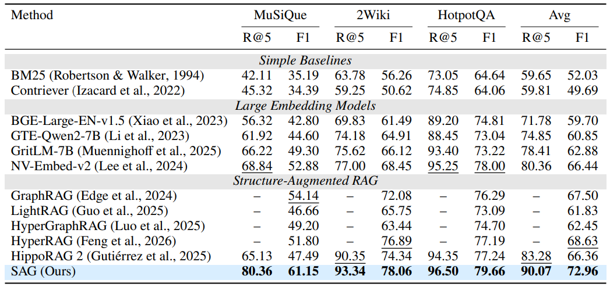
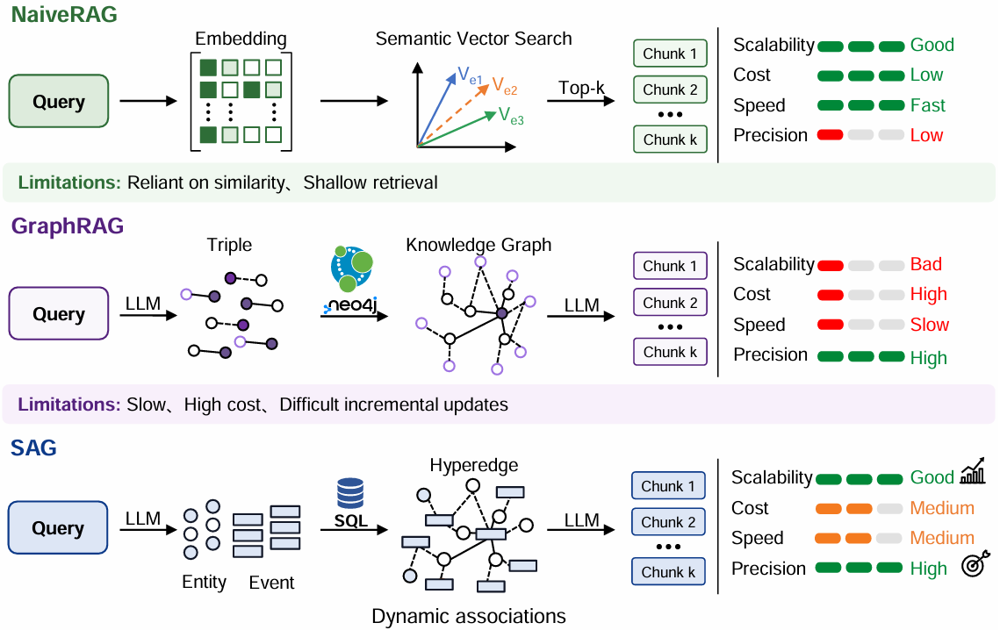
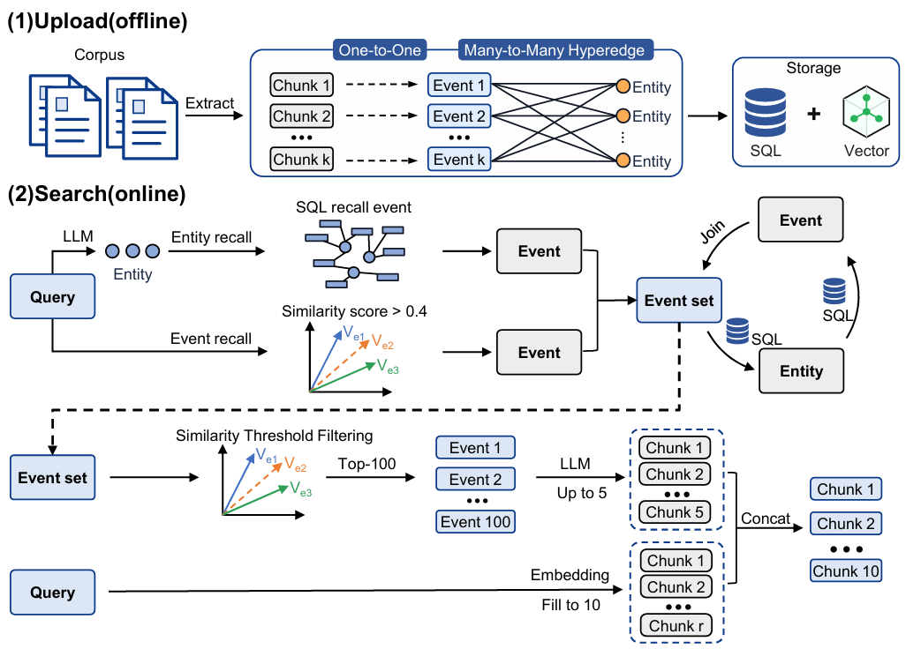

> **原 SAG 论文复现。** [SAG2指南](../sag2/README-CN.md) · [项目首页](../README-CN.md) · [English](README.md)
>
> 本页介绍事件／实体图检索。除首次克隆和进入目录外，以下命令均在 **SAG-Benchmark/sag/** 执行，使用本目录的依赖、配置、数据和输出。检索参数为 **`--strategy sag`**。

<p align="center">
  
</p>

# SAG — 原论文复现

> SAG 论文配套 Benchmark 复现代码库。该仓库用于按快速开始命令复现论文中的 Benchmark 分数，普通用户请看[SAG项目](https://github.com/Zleap-AI/SAG)

[English](README.md) | 中文

**论文链接：** [https://arxiv.org/abs/2606.15971](https://arxiv.org/abs/2606.15971)

https://github.com/user-attachments/assets/a080ad1a-5c08-4213-acfa-a226e3c0f68a

文档与资源：[贡献指南](CONTRIBUTING.md) | [安全政策](SECURITY.md) | [支持渠道](SUPPORT.md)

## Benchmark 分数复现

本仓库提供 SAG 在 HotpotQA、2WikiMultiHopQA 和 MuSiQue 上的上传、检索与评估脚本。当前快速开始流程支持复现 SAG、BM25 以及 bge-large-en-v1.5 向量检索结果，并通过 atomic 上传/检索路径支持 Triple indexing 消融实验。

论文默认实验配置：

| 配置项 | 值 |
|------|------|
| Embedding | `bge-large-en-v1.5` |
| LLM | `qwen3.6-flash` |
| 论文主要指标 | Recall@5 / F1 |
| 主要脚本 | `scripts/run_upload.py`、`scripts/run_search_benchmark.py`、`scripts/run_qa_benchmark.py` |

主要结果：

<p align="center">
  
</p>

在 HotpotQA、2WikiMultiHopQA 和 MuSiQue 上的实验表明，SAG 在每个基准测试中均取得最佳的检索与端到端 QA 性能。

- SAG 在三个数据集上的平均 Recall@5 和 F1 为 **90.07%/72.96%**，相比最强基准分别提升 **6.79/4.33** 个百分点。
- 在最具挑战的 MuSiQue 上，Recall@5 和 F1 较各指标的最强基准分别提升 **11.52/7.01** 个百分点。

> **注意：** 当前 CLI 支持复现 SAG、BM25 和 bge-large-en-v1.5 向量检索结果；atomic 上传/检索用于 Triple indexing 消融实验。

## 方法图示

<p align="center">
  
</p>

SAG 将文本组织为轻量的 `chunk -> event`、`chunk -> entities`、`event <-> entities` 结构。它不维护重型全局知识图谱，而是把 event/entity 索引用于 SQL、向量、全文检索和多跳扩展。

<p align="center">
  
</p>

## 快速开始

### 1. 安装依赖

要求：

- Python 3.11+
- `uv`
- Docker Compose
- 可用的 LLM 和 Embedding 服务端点；只有运行 final selection 的 reranker 消融实验时才需要 Rerank 服务

```bash
git clone https://github.com/Zleap-AI/SAG-Benchmark.git
cd SAG-Benchmark/sag
uv sync --frozen
test -f .env || cp .env.example .env
```

已有本仓库时，从仓库根目录执行 `cd sag`，然后安装依赖。两套实现的目录对应如下：

| 内容 | 从仓库根目录计算的路径 |
|---|---|
| 原SAG代码与依赖 | `sag/pipeline/`、`sag/scripts/`、`sag/.venv/` |
| 原SAG配置 | `sag/.env` |
| 原SAG数据 | `sag/dataset/` |
| 原SAG结果 | `sag/output/`、`sag/evaluation/` |
| SQLite SAG2实现 | `sag2/`，使用自己的配置、依赖和索引 |

如果需要直接运行 Python 命令，可以先激活虚拟环境：

```bash
source .venv/bin/activate
```

Windows PowerShell 使用：

```powershell
.\.venv\Scripts\Activate.ps1
```

编辑 `.env`，填写存储后端、LLM 和 Embedding 配置。复现标准 SAG 只需要这三组配置；只有运行下面的 final selection reranker 消融实验时，才需要补充 Rerank 配置。

默认读取 `sag/.env`。使用其他配置文件时，在启动前设置 `SAG_ENV_FILE`；相对路径按 `sag/` 解析。

上传或检索前，至少检查这些 `.env` 配置：

```env
STORAGE_PROFILE=mysql_es

LLM_API_KEY=sk-...
LLM_BASE_URL=https://...
LLM_MODEL=qwen3.6-flash
LLM_LANGUAGE=en

EMBEDDING_API_KEY=...
EMBEDDING_BASE_URL=http://...
EMBEDDING_MODEL_NAME=text-embedding-bge-large-en-v1.5
EMBEDDING_DIM=1024
```

只有运行 final selection reranker 消融实验时才需要补充以下配置：

```env
RERANK_BASE_URL=http://...
RERANK_MODEL_NAME=Qwen/Qwen3-Reranker-8B
RERANK_ENDPOINT=/rerank
```

然后按当前 profile 填写对应的存储连接：

```env
# mysql_es
MYSQL_HOST=localhost
MYSQL_PORT=3306
MYSQL_USER=sag2
MYSQL_PASSWORD=sag2_pass
MYSQL_DATABASE=sag2

# oceanbase_es / oceanbase_full
OCEANBASE_HOST=localhost
OCEANBASE_PORT=2881
OCEANBASE_USER=sag2@sag2
OCEANBASE_PASSWORD=sag2_pass
OCEANBASE_DATABASE=sag2

# mysql_es / oceanbase_es
ES_HOST=localhost
ES_PORT=9200
ES_SCHEME=http
```

存储后端通过 `STORAGE_PROFILE` 选择。应用层统一调用存储门面，上传和检索逻辑不需要知道向量最终写入 Elasticsearch 还是 OceanBase。

| Profile | SQL 数据库 | 向量/搜索后端 | 说明 |
|------|------|------|------|
| `mysql_es` | MySQL | Elasticsearch | 默认论文复现兼容模式 |
| `oceanbase_es` | OceanBase | Elasticsearch | 结构化表使用 OceanBase，向量搜索仍使用 ES |
| `oceanbase_full` | OceanBase | OceanBase | 向量直接存入 OceanBase 主表列，并使用 OceanBase 向量索引检索 |

`DATABASE_BACKEND` 和 `VECTOR_BACKEND` 是高级覆盖项。一般保持为空，让系统根据 `STORAGE_PROFILE` 自动推导。

### 2. 启动基础服务

所有本地服务由 `docker-compose.yml` 管理。

| 服务 | 容器名 | 默认端口 | 说明 |
|------|--------|----------|------|
| MySQL | `sag2_mysql` | `3306` | 默认用户 `sag2` |
| Elasticsearch | `new_sag_elasticsearch` | `9200` | 已关闭安全认证 |
| OceanBase | `oceanbase-ce` | `2881` | `oceanbase_es` / `oceanbase_full` 可选后端 |
| MLflow | `sag2_mlflow` | `5000` | 可选实验记录 |

端口可在 `.env` 中通过 `MYSQL_PORT`、`ES_PORT`、`MLFLOW_PORT` 覆盖。OceanBase SQL 客户端端口为 `2881`。

按当前 `STORAGE_PROFILE` 选择一个启动方式即可，不需要全部执行。

#### 2.1 `mysql_es`

```bash
docker compose up -d mysql elasticsearch
docker compose ps
```

#### 2.2 `oceanbase_es`

```bash
docker compose up -d oceanbase elasticsearch
docker compose ps
```

使用 `oceanbase_es` 时，需要等 OceanBase 容器日志显示租户 DDL 已就绪并完成 `init.sql` 后，再执行项目初始化：

```text
==> sag2 tenant ready.
==> Waiting for sag2 tenant DDL...
==> sag2 tenant DDL ready.
==> init.sql executed.
==> All done.
```

#### 2.3 `oceanbase_full`

```bash
docker compose up -d oceanbase
docker compose ps
```

使用 `oceanbase_full` 时，同样需要等 OceanBase 容器日志显示租户 DDL 已就绪并完成 `init.sql`：

```text
==> sag2 tenant ready.
==> Waiting for sag2 tenant DDL...
==> sag2 tenant DDL ready.
==> init.sql executed.
==> All done.
```

如果需要 MLflow 实验记录，可以单独启动：

```bash
docker compose up -d mlflow
```

### 3. 初始化数据库和索引

按当前 `STORAGE_PROFILE` 选择一个初始化方式即可，不需要全部执行。

#### 3.1 `mysql_es`

```bash
uv run python scripts/init_database.py --fix-grants
uv run python scripts/init_elasticsearch.py
```

#### 3.2 `oceanbase_es`

```bash
uv run python scripts/init_database.py
uv run python scripts/init_elasticsearch.py
```

#### 3.3 `oceanbase_full`

```bash
uv run python scripts/init_database.py
```

`scripts/init_database.py` 会读取 `STORAGE_PROFILE` 并初始化当前 SQL 后端：

- `mysql_es`：创建普通 MySQL 结构化表。
- `oceanbase_es`：创建普通 OceanBase 结构化表，并补齐 OceanBase 专用兼容列，例如 `source_event.entities`。
- `oceanbase_full`：包含 `oceanbase_es` 的所有步骤，并幂等补齐 chunk、event、entity、event-entity 的 OceanBase 向量列和向量索引。

只有向量后端是 Elasticsearch 时才需要执行 `scripts/init_elasticsearch.py`，也就是 `mysql_es` 或 `oceanbase_es`。`oceanbase_full` 不需要 ES 索引初始化。`--fix-grants` 只用于本地 MySQL 权限修复，OceanBase profile 不要使用。

**`init_elasticsearch.py` 如何确定 embedding 维度**

脚本默认向配置的 embedding 模型发一条探测请求，直接测出实际向量维度，然后创建带维度后缀的 4 个物理索引（`source_chunks_4096`、`event_vectors_4096` 等）。结果缓存在 `.cache/embedding_dims.json`，后续运行直接读缓存，无需重复请求。

```bash
# 标准用法 —— 自动从 .env 配置的 embedding 模型探测维度
uv run python scripts/init_elasticsearch.py

# 忽略缓存，强制重新探测
uv run python scripts/init_elasticsearch.py --refresh-dim

# 跳过探测，直接指定已知维度
uv run python scripts/init_elasticsearch.py --dim 4096
```

脚本是幂等的：索引已存在且维度匹配则跳过；已存在但维度不符则立即报错，不会静默留下损坏的索引。`ES_INDEX_LEGACY_UNSUFFIXED=true` 时，1024 维的 legacy 无后缀索引（`source_chunks` 等）会被原样保留。

`run_upload.py` 在写入任何数据前会验证目标索引存在且维度正确。若索引缺失或被 Elasticsearch 的 auto_create_index 自动建成了 mapping 错误的"野生索引"，上传会立即退出并给出可操作的错误提示。

### 4. 上传数据集

本节的 `dataset/` 指 `SAG-Benchmark/sag/dataset/`。若已通过SAG2下载MuSiQue，可从当前 `sag/` 目录复制同一对数据文件，保留已有文件：

```bash
cp -n ../sag2/dataset/musique.json ../sag2/dataset/musique_corpus.json dataset/
```

HotpotQA和2WikiMultiHopQA可按数据集名称替换；未下载时按下方来源准备。

上传前请先准备数据文件：

- `test_hotpotqa` 和 `sample` 已随仓库提供。
- 运行 `hotpotqa`、`musique`、`2wikimultihopqa` 或 `narrativeqa` 时，请从
  [HippoRAG 2 数据发布](https://huggingface.co/datasets/osunlp/HippoRAG_2/tree/main)
  下载对应的 `*.json` 与 `*_corpus.json` 文件，并放入 `dataset/`。完整文件结构、
  数据来源、许可和引用要求见 [dataset/README.md](dataset/README.md)。

`run_upload.py` 会先把 `dataset/<dataset>.json` 转为 Markdown corpus，再通过统一存储门面写入结构化数据和向量。`mysql_es` 会写入 MySQL + Elasticsearch，`oceanbase_full` 会把结构化数据和向量都写入 OceanBase。上传完成后会生成：

```text
pipeline/evaluation/source/SAG/<模型名末段>/<dataset>/<timestamp>/source_info.json
```

该文件包含后续benchmark使用的 `source_config_id`。模型名包含 `/` 时，目录只使用最后一段，例如 `provider/model-name` 对应 `model-name/`。

```bash
uv run python scripts/run_upload.py --dataset hotpotqa
uv run python scripts/run_upload.py --dataset 2wikimultihopqa
uv run python scripts/run_upload.py --dataset musique
```

快速调试可先使用小数据集：

```bash
uv run python scripts/run_upload.py --dataset test_hotpotqa
uv run python scripts/run_upload.py --dataset sample
```

如果要复现**三元组（原子事项）**模式——即每个事项恰好包含 2 个实体（主体-关系-客体）——在上传时加上 `--atomic`：

```bash
uv run python scripts/run_upload.py --dataset sample --atomic
```

上传阶段提供三种模式：

| 模式 | 命令 | 行为 |
|------|------|------|
| Compact（默认） | `uv run python scripts/run_upload.py --dataset musique` | 使用精简提取提示词，生成融合后的事项；不需要额外参数。 |
| Atomic | `uv run python scripts/run_upload.py --dataset musique --atomic` | 使用原子事项模板，每个事项约束为主体-关系-客体结构。 |
| 不提取事项（仅 Vector） | `uv run python scripts/run_upload.py --dataset musique --no-extraction` | 只加载并建立语料索引，不调用事项/实体提取；仅在只运行纯 embedding 的 `vector` 搜索时使用。 |

一次上传选择一种模式。当前 SAG 或 SAG 与 vector/BM25 对比实验都应使用默认的 Compact。如果只想运行纯 Vector 搜索、不运行 SAG，才使用 `--no-extraction`；因为 SAG 依赖提取出的事项，所以计划运行 SAG 时不要传这个参数。


### 5. 运行搜索

#### 5.1 最短命令

```bash
uv run python scripts/run_search_benchmark.py \
  --dataset-name musique \
  --strategy sag
```

省略的参数使用内置默认值：`top-k=10`、`k-values=1,2,5,10`、`max-concurrency=10`、`bench-size=5`。这组默认值即论文配置，直接运行即为论文的 SAG 检索复现路径。运行其他主要数据集时，将 `musique` 替换为 `hotpotqa` 或 `2wikimultihopqa`。

#### 5.2 常用参数调整

以下参数按需追加到 5.1 的命令之后：

```bash
# 调整并发数（默认 10）
--max-concurrency 20

# 只跑前 N 题（默认不限制）
--limit 10

# 固定某次上传的数据源（默认自动选择最新上传；ID 来自第 4 节上传生成的 source_info.json）
--source-config-id YOUR_SOURCE_CONFIG_ID
```

完整参数表见 [docs/search.md](docs/search.md)。

#### 5.3 其他检索策略与变体

以下命令只列出与默认值不同的参数，其余与 5.1 相同。

##### SAG Scope（事件候选池）

打开候选池并通过 `--sag-event-top-k` 设置候选池大小 `k_pool`。该变体应作为与 vector、atomic 同级的独立实验配置记录：

```bash
uv run python scripts/run_search_benchmark.py \
  --dataset-name musique \
  --strategy sag \
  --sag-scope \
  --sag-event-top-k 500
```

##### Atomic（Triple indexing）

先以 atomic 模式上传，再用 atomic 策略检索：

```bash
uv run python scripts/run_upload.py --dataset musique --atomic
uv run python scripts/run_search_benchmark.py \
  --dataset-name musique \
  --strategy atomic
```

##### BM25

Elasticsearch BM25 关键词检索基线，无额外参数：

```bash
uv run python scripts/run_search_benchmark.py \
  --dataset-name musique \
  --strategy bm25
```

##### Vector

默认 Compact 上传后即可直接运行纯向量检索：

```bash
uv run python scripts/run_search_benchmark.py \
  --dataset-name musique \
  --strategy vector
```

如果实验需要同时比较 Vector 和 SAG，应使用默认 Compact 上传，使同一个数据源包含 SAG 所需的事项数据。仅跑纯 Vector 时也可以用 `--no-extraction` 上传跳过事项提取，但该数据源将无法运行 SAG、需要重新上传，权衡详见 [docs/search.md](docs/search.md)。

#### 5.4 工具集成

启用 MLflow 实验记录：

```bash
uv run python scripts/run_search_benchmark.py \
  --dataset-name musique \
  --strategy sag \
  --use-mlflow \
  --mlflow-url http://localhost:5000 \
  --mlflow-experiment sag-benchmark
```

#### 输出

输出目录默认是：

```text
output/<dataset>/<strategy>/<timestamp>/
```

主要输出文件：

| 文件 | 说明 |
|------|------|
| `search_results.json` | 每条问题的检索结果 |
| `benchmark_results.json` | Recall、Precision、F1 等评估结果 |
| `run.log` | 本次运行日志 |

### 6. 使用检索结果运行 QA

`run_qa_benchmark.py` 读取检索阶段生成的 `search_results.json`，将检索片段放入 QA prompt，由配置的 LLM 生成答案并计算 EM/F1。结果默认写入输入文件旁边的新 `qa_<时间戳>/` 目录。

```bash
uv run python scripts/run_qa_benchmark.py \
  --dataset-name musique \
  --input output/musique/sag/YOUR_SEARCH_RUN_ID/search_results.json \
  --qa-top-k 5
```

`--qa-top-k` 控制每道题送入 QA prompt 的检索片段数量。主要结果文件是 `qa_results.json`；可用 `--output-dir` 指定输出目录，用 `--max-concurrency` 和 `--limit` 控制并发数与处理范围。

### 7. 运行其他项目

外部方法位于 `sag/external/`，各自安装依赖。命令从对应方法目录执行，通过 `--env-file ../../.env` 读取 `sag/.env`；完成后回到 `sag/` 执行Judge。各项目的建索引、检索、问答、输出和参数见对应README。

| 方法 | 使用说明 |
|---|---|
| Microsoft GraphRAG | [external/graphrag/README.md](external/graphrag/README.md) |
| HippoRAG 2 | [external/hipporag2/README.md](external/hipporag2/README.md) |
| HyperGraphRAG | [external/hypergraphrag/README.md](external/hypergraphrag/README.md) |
| Hyper-RAG | [external/hyperrag/README.md](external/hyperrag/README.md) |
| LightRAG | [external/lightrag/README.md](external/lightrag/README.md) |

可在 [external/README.md](external/README.md) 查看所有已集成方法的总览。某个方法完成原生运行后，使用下面的 LLM Judge 工作流将其输出转换到统一评测目录并进行评估。

### 8. 使用 LLM Judge

run_llm_judge.py 将某个方法最新的原生输出转换为统一 predictions 格式，并运行 generation、retrieval，以及可选的 indexing 指标。每次运行结束后，命令行会打印本次请求的每项指标数值及有效样本数。

Judge使用独立的模型配置。在 `sag/.env` 中填写下列变量；接口可以与主LLM相同：

```dotenv
JUDGE_LLM_API_KEY=your_judge_key
JUDGE_LLM_BASE_URL=https://your-provider.example/v1
JUDGE_LLM_MODEL=your_judge_model
```

配置由 `pipeline/core/ai/factory.py` 读取。若要显式共用主LLM的配置，可设置 `JUDGE_ALLOW_FALLBACK=true`。

一键完成转换、generation 与 retrieval：

```bash
uv run --frozen --env-file .env python scripts/run_llm_judge.py \
  --project hypergraphrag \
  --dataset musique
```

完整子命令说明、参数表、指标路由与输出目录结构见 [docs/judge.md](docs/judge.md)。

如需单独运行评估，先转换原生输出，再选择需要的指标。`evaluate` 子命令可在同一个 Judge run 中运行 generation 和/或 retrieval 评估，指标按名称自动路由到对应阶段：

```bash
uv run --frozen --env-file .env python scripts/run_llm_judge.py convert \
  --project hypergraphrag \
  --datasets musique

uv run --frozen --env-file .env python scripts/run_llm_judge.py evaluate \
  --project hypergraphrag \
  --dataset musique \
  --metrics context_relevancy,evidence_recall
```

核心 SAG 使用 `--project sag`。该入口固定为 `sag` 策略，并自动选择 `output/<dataset>/sag/<run_id>/` 下最新的**完整**运行：同一运行目录必须同时存在 `search_results.json` 和 `qa_*/qa_results.json`。因此请先运行 QA benchmark，再执行：

```bash
uv run --frozen --env-file .env python scripts/run_llm_judge.py \
  --project sag \
  --dataset musique
```

generation 指标包括 answer_correctness、coverage_score、qa_em、qa_f1、rouge_score；retrieval 指标包括 context_relevancy、evidence_recall。`--metrics` 可混选两个阶段的任意指标，并按名称自动路由到对应阶段；省略时默认评测全部 generation 与 retrieval 指标（无 evidence 能力的数据集自动剔除 evidence_recall）。在 `--metrics` 中加入 `indexing` 会在同一次 Judge run 中额外运行图索引指标（需要 `--framework` 和 `--base-path`）；不传则默认不跑 indexing。

`indexing` 子命令也可单独使用，向已有 Judge run 补跑图索引指标，不重跑 generation/retrieval。HyperGraphRAG 的图输出为 graphml，`--framework` 支持值清单见 [docs/judge.md](docs/judge.md)：

```bash
uv run --frozen --env-file .env python scripts/run_llm_judge.py indexing \
  --project hypergraphrag \
  --dataset musique \
  --framework graphml \
  --base-path /path/to/graph/output \
  --resume-run-id YOUR_JUDGE_RUN_ID
```

#### 恢复失败的 Judge 样本

每个结果文件的 `detailed` 字段都会记录逐样本状态、错误类型和错误信息。先修正根本原因（例如 API 端点或模型配置），再通过 `--retry-failed` 续跑同一个 Judge run。已成功的样本和已有的有效指标会保留，只会再次请求此前失败的样本。

```bash
# 只重跑失败的样本（retrieval 指标按名称选择）。
# Judge run ID 使用初次运行时命令行打印的 ID。
uv run --frozen --env-file .env python scripts/run_llm_judge.py evaluate \
  --project hypergraphrag \
  --dataset musique \
  --metrics context_relevancy,evidence_recall \
  --resume-run-id YOUR_JUDGE_RUN_ID \
  --retry-failed
```

generation/retrieval 单阶段恢复请使用 `evaluate`（已取代 `generation`、`retrieval` 子命令，通过 `--metrics` 表达单阶段选择，含 indexing 也通过 `--metrics indexing` 触发）。`--retry-failed` 必须与 `--resume-run-id` 一起使用，且不能与 `--force` 或 `--force-metrics` 同时使用；`--top-k` 是评测行数上限而非检索 k。无子命令的一键自动模式不支持续跑。完整参数约束见 [docs/judge.md](docs/judge.md)。

`--top-k` 是只评测 predictions 前 N 条样本的上限，**不会**改变检索结果的 k。`--context-top-k` 才控制每项 Judge 指标读取多少条已保存的 contexts。二者都会进入续跑契约：续跑时应保持和初次运行相同的值。若要改变任一参数，请新建 Judge run，不要与 `--retry-failed` 组合使用。

### 9. 复现 SAG 消融实验结果

下面的实验对应论文 Table 6。请在 MuSiQue 上固定数据集、数据源配置、Embedding 模型和 `top-k`，每次只修改对应的实验组件。

#### Default SAG

使用默认 Compact 上传和 `sag` 搜索策略。默认 final selection 为 `llm_rank`。

```bash
uv run python scripts/run_upload.py --dataset musique
uv run python scripts/run_search_benchmark.py \
  --dataset-name musique \
  --strategy sag \
  --top-k 10 \
  --k-values "1,2,5,10"
```

#### Indexing with Triple indexing

上传时使用 atomic 提示词，搜索时选择 `atomic` 策略：

```bash
uv run python scripts/run_upload.py --dataset musique --atomic
uv run python scripts/run_search_benchmark.py \
  --dataset-name musique \
  --strategy atomic \
  --top-k 10 \
  --k-values "1,2,5,10"
```

#### Expansion without expansion（`L=0`）

在 `pipeline/modules/search/config.py` 中，将 `SAGGraphExpandConfig.enabled` 从：

```python
enabled: bool = Field(default=True, description="是否启用扩展")
```

临时改为：

```python
enabled: bool = Field(default=False, description="是否启用扩展")
```

然后使用默认 Compact 上传，并运行 `--strategy sag`。消融实验完成后恢复 `default=True`，以保证普通 SAG 使用一跳扩展。

#### Final selection with Qwen3-Reranker-8B

在 `pipeline/modules/search/config.py` 中，将 `SAGGraphRerankConfig.strategy` 的默认 LLM 选择：

```python
strategy: Literal["rerank", "llm_rank", "rrf"] = Field(
    default="llm_rank", description="排序策略"
)
```

临时改为：

```python
strategy: Literal["rerank", "llm_rank", "rrf"] = Field(
    default="rerank", description="排序策略"
)
```

在 `.env` 中配置 `RERANK_BASE_URL`、`RERANK_MODEL_NAME=Qwen/Qwen3-Reranker-8B` 和 `RERANK_ENDPOINT`，然后使用默认 Compact 上传并运行 `--strategy sag`。实验完成后恢复 `default="llm_rank"`。

#### 论文消融结果：MuSiQue

| 阶段 | 配置 | R@1 | R@2 | R@5 | R@10 |
|------|------|------:|------:|------:|------:|
| Default SAG（Ours） | 默认配置 | **36.82** | **63.62** | **80.36** | **83.37** |
| Indexing | Triple indexing | 35.66 | 61.83 | 77.61 | 81.54 |
| Expansion | w/o Expansion（`L=0`） | 35.70 | 57.75 | 69.41 | 74.76 |
| Final selection | Qwen3-Reranker-8B | 32.12 | 48.97 | 67.11 | 76.51 |

Default 行使用 hyperedge indexing、一跳扩展（`L=1`）和 Qwen3.6-Flash final selection。比较各行时，其余配置必须保持一致。

## 数据集

| 名称 | 说明 |
|------|------|
| `hotpotqa` | HotpotQA 多跳问答 |
| `2wikimultihopqa` | 2WikiMultiHopQA |
| `musique` | MuSiQue 多跳问答 |
| `test_hotpotqa` | HotpotQA 小测试集 |
| `sample` | 极小样本集，用于流程调试 |

数据文件位于 `dataset/`。仓库只附带 `sample` 与 `test_hotpotqa`；完整基准数据集（`hotpotqa`、`musique`、`2wikimultihopqa`、`narrativeqa`）请从 [HippoRAG 2 数据发布](https://huggingface.co/datasets/osunlp/HippoRAG_2/tree/main)下载后放入 `dataset/`，出处与许可说明见 [dataset/README.md](dataset/README.md)。

## 检索策略

| 策略 | 说明 |
|------|------|
| `sag` | SAG 图召回、扩展和 LLM 重排 |
| `sag` + `--sag-scope` | SAG 事件候选池变体；`--sag-event-top-k` 设置 `k_pool` |
| `atomic` | 原子检索，先拆实体再逐跳扩展 |
| `vector` | 纯向量检索基线 |
| `bm25` | Elasticsearch BM25 关键词检索基线 |
| `multi_es` | Elasticsearch优先的事件／实体检索，使用 `--mode fast` 或 `--mode precise` |

完整参数见 [docs/search.md](docs/search.md)。

## 常用脚本

### 纯搜索

```bash
uv run python scripts/run_search.py \
  --dataset-name test_hotpotqa \
  --strategy sag \
  --output-dir output/manual-search
```

仅检索脚本的 `--output-dir` 是输出根目录。上例实际写入 `output/manual-search/search_results/test_hotpotqa/<timestamp>/search_results.json`，与 `run_search_benchmark.py` 的目录结构不同。

### 纯评估

```bash
uv run python scripts/run_benchmark.py \
  --results output/musique/sag/YOUR_SEARCH_RUN_ID/search_results.json \
  --dataset musique
```

## 项目结构

```text
SAG-Benchmark/
├── README.md / README-CN.md       # 项目首页，以SAG2为主
├── sag2/                         # SQLite SAG2与可选扩展
└── sag/                          # 本文档的工作目录
    ├── README.md / README-CN.md
    ├── .env.example / pyproject.toml / uv.lock
    ├── assets/ / dataset/ / prompts/
    ├── pipeline/
    │   ├── core/ / db/ / storage/
    │   ├── evaluation/           # 指标、Judge、数据加载
    │   └── modules/
    │       ├── extract/ / load/
    │       └── search/
    │           ├── sag_graph/   # SAG图检索实现
    │           ├── config.py    # SAGGraphExpandConfig等配置
    │           └── searcher.py
    ├── scripts/
    │   ├── init_database.py / init_elasticsearch.py
    │   ├── run_upload.py / run_search_benchmark.py
    │   ├── run_search.py / run_qa_benchmark.py
    │   └── run_benchmark.py / run_llm_judge.py
    ├── external/ / docs/ / tests/
    └── docker-compose.yml / init.sql / ob-start.sh
```

## 复现注意事项

- 结果依赖 `.env` 中实际配置的 LLM、Embedding、Rerank 服务；模型、维度或 rerank 配置变化会影响指标。
- 存储行为由 `STORAGE_PROFILE` 决定。初始化、上传、搜索建议保持同一个 profile，除非你明确在做数据迁移。
- OceanBase 向量检索统一使用 `COSINE` 距离，并基于返回的 cosine distance 转成兼容 ES 习惯的 `_score`。近似 ANN 检索使用 OceanBase `APPROX LIMIT ... PARAMETERS (ef_search=...)`。
- `run_search_benchmark.py` 未显式传 `--source-config-id` 时，会按 `.env` 的 `LLM_MODEL` 查找最新上传的数据源。
- 完整数据集上传和 benchmark 会调用外部模型服务，运行前请确认额度、并发和超时配置。
- 停止本地服务使用 `docker compose down`；如需删除本地数据库卷，使用 `docker compose down -v`，该操作会清空已上传数据。
