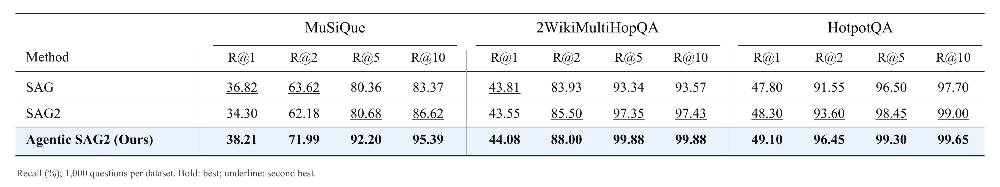
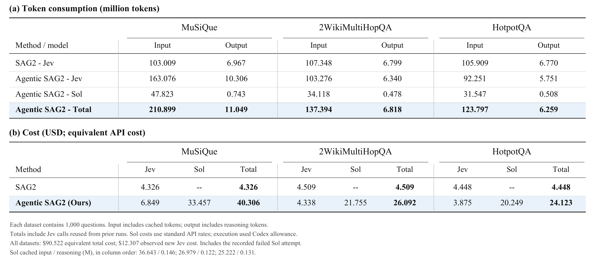

# Agentic SAG2：SAG2 的可选扩展

本页命令在仓库的 `sag2/` 目录执行。[SAG2中文首页](../README-CN.md) · [项目首页](../../README-CN.md)

本页介绍 SAG2 的可选 Agentic 扩展。项目主方法、论文结果与默认运行方式见 [SAG2 README](../README.md)。两个模式共用同一个 SQLite FTS5 索引和 SAG2 检索实现。

- **SAG2**：从问题检索段落，根据证据选择词项，再检索关联段落，由 Jev `noul` 评分。
- **Agentic SAG2**：LLM 将 SAG2 作为工具调用。它保留原问题、历史结果、已确认关系和未解决关系，自主决定下一次查询或停止，最后从工具返回的候选中选择并排序。

**Agentic 模式直接使用模型 API。复现不需要安装 Codex，也不需要 Codex 账号、作者的 SSH 配置或实验目录。** 模型、服务商接口、思考档位、每次 SAG2 的扩展轮数均可配置。

语料导入只做本地文本处理和索引构建。正式流程不添加 LLM 批注，不调用嵌入模型，不预建全局段落关系图。

## 最终检索结果

三个数据集各评测 1,000 题。数值为百分比；原版 SAG 引自原论文 Table 4，SAG2 与 Agentic SAG2 使用保存的完整逐题结果。



| 方法 | MuSiQue R@5 / R@10 | 2Wiki R@5 / R@10 | HotpotQA R@5 / R@10 |
|---|---:|---:|---:|
| SAG | 80.36 / 83.37 | 93.34 / 93.57 | 96.50 / 97.70 |
| SAG2 | 80.675 / 86.617 | 97.350 / 97.425 | 98.450 / 99.000 |
| **Agentic SAG2** | **92.200 / 95.392** | **99.875 / 99.875** | **99.300 / 99.650** |

| 前10段包含全部标准证据的题数 | MuSiQue | 2Wiki | HotpotQA |
|---|---:|---:|---:|
| SAG2 | 695 | 931 | 981 |
| Agentic SAG2 | 891 | 997 | 994 |

Agentic 最佳结果设置：**gpt-6.1-sol、high 思考、普通速度、并发20，每次 SAG2 扩展1轮，每题最多调用3次，每次返回20段，最终选择10段**。

评测采用原生MCP运行，通用API入口使用相同的提示词、检索方法和工具调用规则。模型、参数与数据来源见[结果来源](../results/agentic/provenance.json)。

## Agentic 检索过程

1. LLM 接收原问题和检索规则，首轮使用原问题原文调用 `sag2_search`。
2. SAG2 先做 BM25，再执行指定轮数的词项扩展与 Jev 评分，返回候选原文和段落编号。
3. LLM 在完整对话历史中阅读结果，记录已确认关系和未解决关系。它可以针对缺失关系继续调用工具，也可以直接结束。
4. LLM 输出候选编号排序。程序验证编号来自实际返回结果，再映射到原文段落并去重评分。

规划、停止和最后排序都由模型决定，没有额外的规划器或复核器。Jev 的评分提示词不变；后续搜索携带原问题与已找到的证据，避免只围绕改写查询评分。

| 参数 | Agentic 默认值 | 说明 |
|---|---:|---|
| `--llm-model` | `gpt-6.1-sol` | 可覆盖为接口支持的模型 ID |
| `--llm-api` | `responses` | `responses` 或 `chat` |
| `--reasoning-effort` | `high` | `default` 表示不传思考参数 |
| `--expansions` / `--max-hops` | 1 | 每次 SAG2 追加扩展轮数，支持0、1、2 |
| `--max-tool-calls` | 3 | 每题最多执行多少次 SAG2 |
| `--return-k` | 20 | 每次工具返回的候选片段数 |
| `--top-k` | 10 | 最后选择的片段数 |
| `--concurrency` | 20 | 同时处理的问题数，HTTP连接上限同为20 |

`responses` 接口保留所有历史输出，包括可传回的推理项；`chat` 接口保留完整消息、工具调用、工具结果及服务商返回的推理字段。API 需要支持原生工具调用；Responses 还需支持结构化输出，Chat 需支持 JSON 输出。接口和模型不会在失败时自动替换。

## 快速开始

需要 Python 3.11+、`uv` 和 C 编译器。首次运行自动编译 SQLite 排序扩展；macOS 可安装 Xcode Command Line Tools，Linux 可使用 GCC。

```bash
uv sync --frozen
test -f .env || cp .env.example .env
```

填写 `.env`；已有配置请保留。使用 OpenAI 兼容的 Responses API 时：

```dotenv
OPENROUTER_API_KEY=your_jev_key
JEV_BASE_URL=https://openrouter.ai/api/alpha/decisions
JEV_MODEL=typesafe/jev-1.13

LLM_API_KEY=your_llm_api_key
LLM_BASE_URL=https://api.openai.com/v1
LLM_MODEL=gpt-6.1-sol
LLM_API=responses
LLM_REASONING_EFFORT=high
```

```bash
# 仅下载缺失数据并建立索引，不调用模型
uv run python scripts/run_sag2_benchmark.py --mode agentic --download --index-only

# Agentic SAG2：先验证 MuSiQue 前10题，仍检索完整语料
uv run python scripts/run_sag2_benchmark.py --mode agentic --dataset musique --limit 10 \
  --output-dir output/sag2/agentic-musique

# Agentic SAG2：三个数据集全量，采用最佳方案参数
uv run python scripts/run_sag2_benchmark.py --mode agentic --datasets all --expansions 1 --concurrency 20

# 模型也可以由 OpenRouter 提供，并复用其 API key
uv run python scripts/run_sag2_benchmark.py --mode agentic --dataset musique --limit 10 \
  --llm-base-url https://openrouter.ai/api/v1 --llm-model openai/gpt-6.1-sol \
  --llm-api responses --llm-api-key-env OPENROUTER_API_KEY

# 保持模型不变，把每次 SAG2 的扩展轮数改为2
uv run python scripts/run_sag2_benchmark.py --mode agentic --dataset musique --expansions 2

# 对支持 Chat 工具调用的模型，不传思考参数
uv run python scripts/run_sag2_benchmark.py --mode agentic --llm-api chat \
  --llm-model "$MODEL_ID" --reasoning-effort default --dataset musique --limit 10

# 接续未完成的运行；模型、接口及其他参数须与原运行相同
uv run python scripts/run_sag2_benchmark.py --mode agentic --dataset musique --limit 10 \
  --resume output/sag2/agentic-musique

# 普通 SAG2 对照：默认追加扩展2轮
uv run python scripts/run_sag2_benchmark.py --mode sag2 --datasets all
```

模型 API 从当前运行机器直接调用。API key 通过环境变量或 `.env` 读取，不写入配置快照、命令参数或请求日志。可使用 `--env-file` 指定配置文件。

`--limit` 仅限制评测题数，不缩小语料。数据来自固定的 HippoRAG 2 发布修订，详见 [数据说明](../dataset/README.md)。默认词法候选上限100、扩展起点10、扩展词项上限20。

## 结果与恢复

默认运行目录为 `output/sag2/<时间>/`，也可用 `--output-dir` 指定。目录内的 `summary.json` 汇总各数据集；以下文件位于各自的 `<数据集>/` 子目录：

- `config.json`：参数、数据及代码校验值。
- `details.jsonl`：逐题检索结果、召回指标和用量。
- `metrics.json`：整体分数、完整证据召回率、Token和请求数。
- `search_results.json` / `bm25_results.json`：最终检索结果及同题BM25对照。
- Agentic 模式的 `requests/<题号>/`：脱敏的 API 请求、响应和对话历史。

运行失败时错误会直接报告。`--resume` 复用已经完成的题目和相同请求的成功响应，不重新发送这些请求。HTTP 499 在当前请求重试，500等临时错误和超时最多重试3次。失败请求单独保留。已经返回200但无法解析的响应需要先检查记录，不会自动重复付费请求。

提供费用字段的服务商会在结果中记录 `provider_cost_usd`；未提供费用时保存为 `null`，不会把未知费用当作0。输入Token包含缓存输入，输出Token包含思考Token，分项不能再次相加。



图中 Sol 费用按 OpenAI 标准 API 单价估算，历史实验使用订阅额度。Jev 全量费用包含复用响应对应的逻辑请求量，新增支出另行标注。当前 API 运行记录真实服务商返回的用量与费用。

## 离线复核

```bash
# 检查保留的3,000题最佳 Agentic 结果，不调用模型
uv run python scripts/verify_agentic_results.py

# 检查原SAG2论文数据，不调用模型
uv run python scripts/verify_paper_results.py

uv run pytest -q
uv run ruff check scripts tests
```
